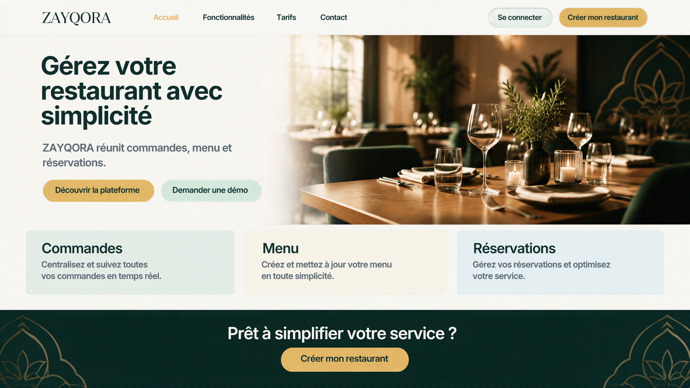
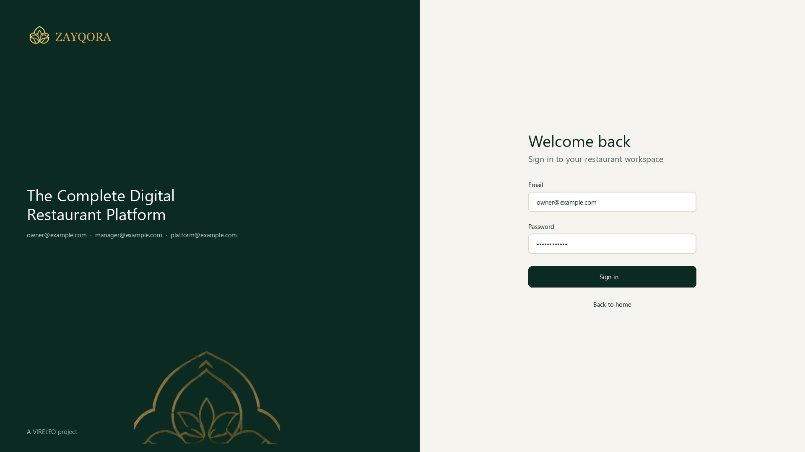
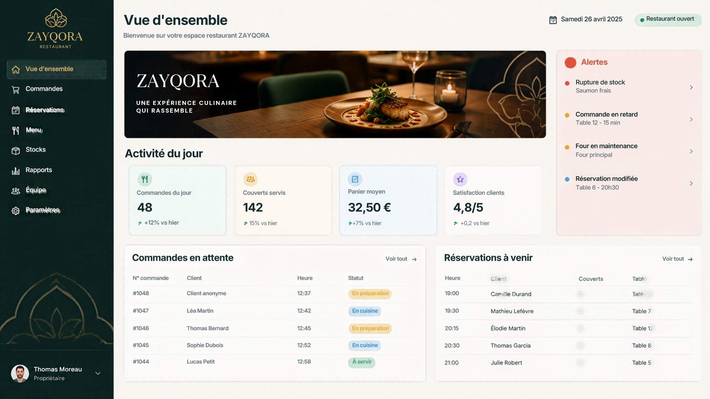
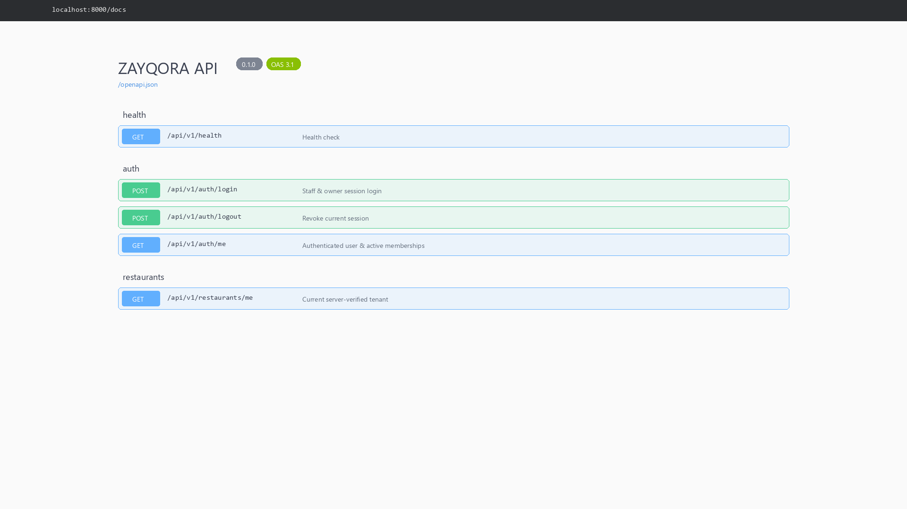
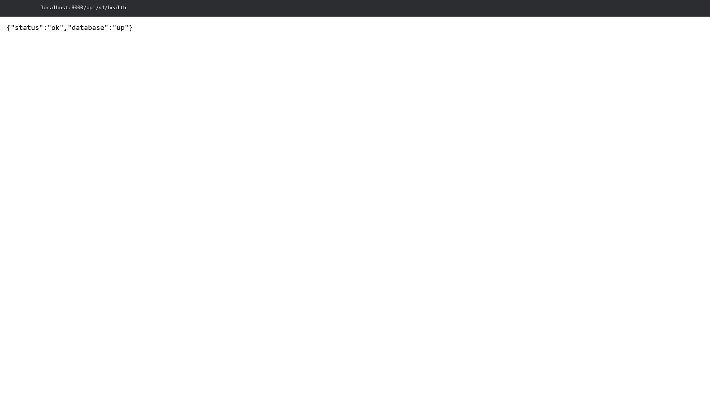
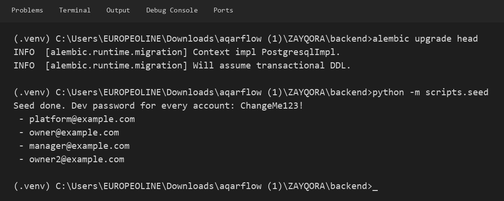
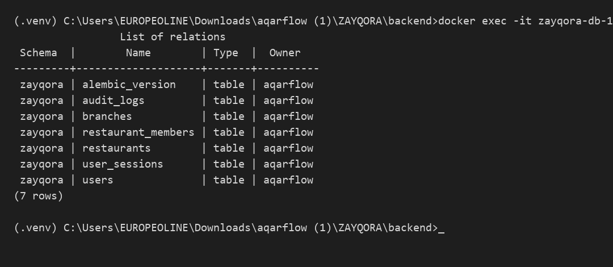

# Day 1 — Foundation

The frontend, the FastAPI backend and the PostgreSQL database run locally, the baseline multi-tenant schema is created by Alembic migrations, and staff can sign in to their restaurant workspace.

## Acceptance criteria covered

| Criterion | Status |
|---|---|
| Repository structure (`backend/`, `frontend/`, `docs/`, `docker-compose.yml`) is in place | ✅ |
| Alembic baseline migration creates core identity, tenant and session tables | ✅ |
| Staff can sign in with `HttpOnly` server-side sessions and access `/dashboard` | ✅ |
| Cross-tenant requests are isolated server-side (`404` masking, `403` when suspended) | ✅ |
| Interface preferences (EN/FR locale with English default, light/dark theme) persist | ✅ |

---

## Public landing page and sign-in

The frontend starts with `npm run dev` on `http://localhost:3000`. Visitors can switch language (EN / FR, English by default) and theme (light / dark), and sign in at `http://localhost:3000/login` using the seeded demo accounts (`owner@example.com` / `ChangeMe123!`).

---

## Frontend workspace and dashboard

Protected workspace routes (`/dashboard`, `/menu`, `/orders`, `/reservations`, `/customers`, `/reports`, `/settings`) are guarded by `middleware.ts` and verified server-side against `/api/v1/auth/me`. After sign-in, `http://localhost:3000/dashboard` displays the active restaurant overview, daily KPIs, alerts, pending orders and upcoming reservations.

---

## API documentation

The API starts with `uvicorn app.main:app --reload --port 8000`, and its interactive Swagger documentation is available at `http://localhost:8000/docs` (`/api/v1/health`, `/api/v1/auth/login`, `/api/v1/auth/logout`, `/api/v1/auth/me`, `/api/v1/restaurants/me`).

---

## Database connection

The health endpoint confirms that the API reaches PostgreSQL: `http://localhost:8000/api/v1/health` returns `{"status":"ok","database":"up"}`.

---

## Database schema and automated tests

`alembic upgrade head` creates the baseline schema (`users`, `user_sessions`, `restaurants`, `restaurant_members`, `branches`, `audit_logs`, plus `alembic_version`), and `python -m scripts.seed` populates demo accounts and restaurants.

Running `pytest -v` in `backend/` executes the 19 automated tests covering Argon2id hashing, session token SHA-256 hashing, rate limiting, CSRF origin checks, multi-tenant isolation and `ROUND_HALF_UP` minor-unit arithmetic.

---

## Layout and navigation

The workspace layout has a sidebar, a top bar (with locale switcher, theme toggle, user profile and sign-out button) and seven navigation items (`Dashboard`, `Menu`, `Orders`, `Reservations`, `Customers`, `Reports`, `Settings`).

---

## Known limitations

- Only `/dashboard` has a full workspace page so far; `/settings`, `/menu`, `/orders`, `/reservations`, `/customers` and `/reports` display a planned-day placeholder screen in `frontend/` until their respective delivery days (Days 2–6).
- Dashboard KPIs, alerts, pending orders and upcoming reservations currently display demo data while the corresponding backend domain tables are scheduled for Days 3–6.
