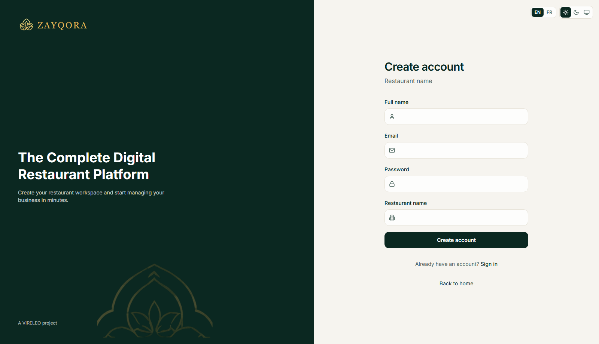
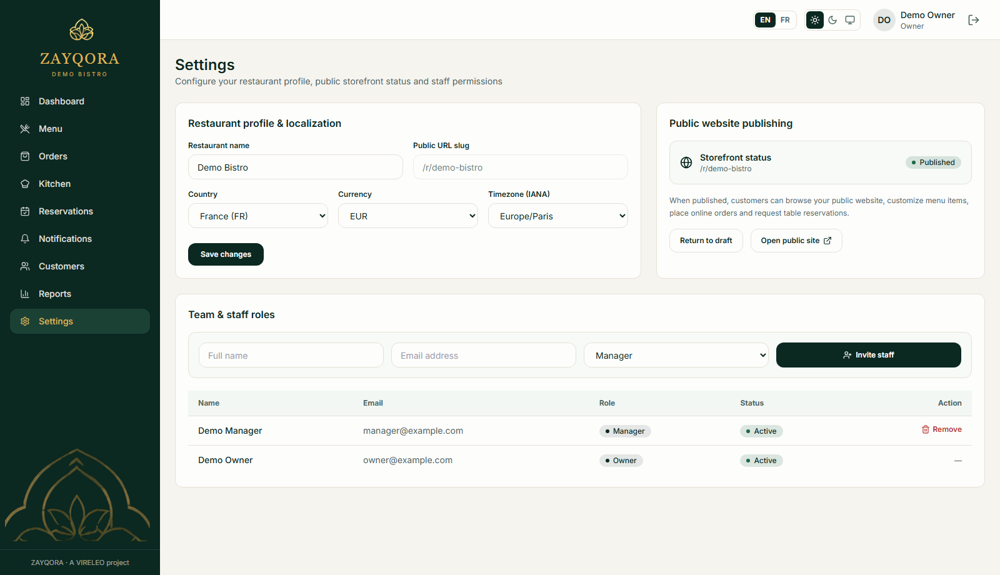
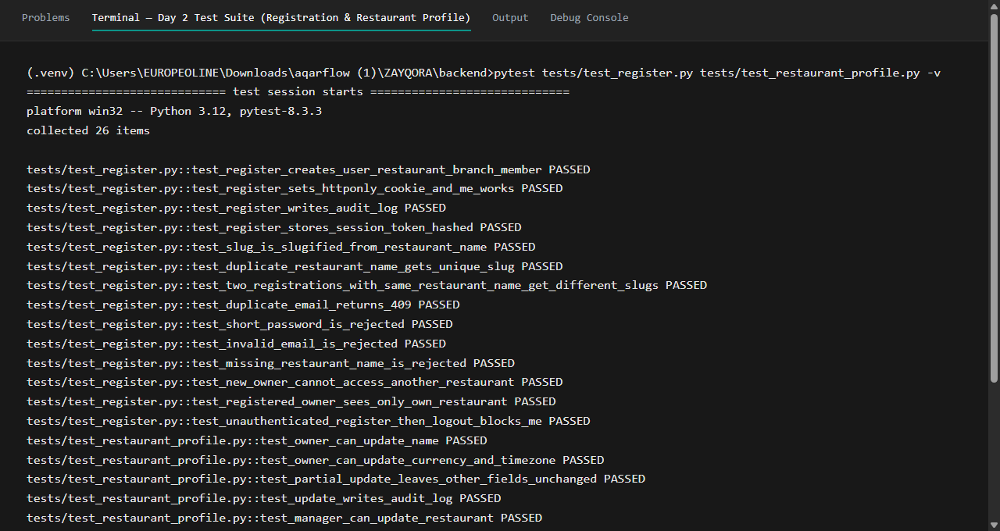

# Day 2 — Tenant Onboarding, Restaurant Profile & Workspace Settings

Restaurant owners can register a new account, which atomically provisions their isolated tenant workspace (`Restaurant`, default `Branch`, and `owner` membership) and signs them in with an `HttpOnly` session cookie. From `/settings`, owners and managers configure localization (`name`, `country`, `currency`, IANA `timezone`), publish or unpublish their public storefront (`/r/{slug}`), and manage staff invitations and role assignments.

## Acceptance criteria covered

| Criterion | Status |
|---|---|
| `POST /api/v1/auth/register` creates user, restaurant, default branch and owner membership in a single transaction | ✅ |
| Registration hashes passwords with Argon2id, stores only the `SHA-256` session token digest, and sets an `HttpOnly` cookie | ✅ |
| Duplicate email returns `409`; short password (`< 8` chars) and invalid email return `422` | ✅ |
| Restaurant URL slug is normalized from the restaurant name and automatically deduplicated (`slug`, `slug-1`, `slug-2`, …) | ✅ |
| `PATCH /api/v1/restaurants/me` allows `owner` and `manager` roles to update `name`, `country`, `currency`, `timezone` and storefront publication state (`active` / `pending`) | ✅ |
| Privileged `suspended` status cannot be set or cleared by tenant members (`422` / `403` enforced server-side) | ✅ |
| Cross-tenant `PATCH` or `GET` attempts with a foreign `X-Restaurant-Id` return `404` and leave the target tenant untouched | ✅ |
| Every state-changing onboarding, profile and team action writes a structured entry to `audit_logs` | ✅ |
| Public `/register` page and workspace `/settings` page (profile, publishing & staff roles) are live and responsive | ✅ |
| Automated test suite covers 26 registration, profile, publishing and tenant-isolation scenarios | ✅ |

---

## Owner registration and automatic tenant provisioning

Visiting `http://localhost:3000/register` allows a new restaurant owner to create their account and workspace in one step. Submitting the form calls `POST /api/v1/auth/register`, which creates:
1. The `User` record with a lowercased email and Argon2id password hash.
2. The `Restaurant` tenant record (`status="pending"` until published from `/settings`) with a unique URL slug.
3. The default `Branch` (`Main branch`, `is_default=True`).
4. The `RestaurantMember` link granting the `owner` role.
5. An `AuditLog` entry (`action="auth.register"`) and an active `UserSession` cookie (`zayqora_session`), redirecting the owner straight to `/dashboard`.

---

## Restaurant profile, storefront publishing and team management (`/settings`)

In the authenticated workspace, `http://localhost:3000/settings` connects to `GET /api/v1/restaurants/me`, `PATCH /api/v1/restaurants/me`, and `/api/v1/members`:

- **Restaurant profile & localization**: Owners and managers configure the display name, country (`FR`, `US`, `GB`, `PK`, `AE`, `CA`), ISO 4217 currency (`EUR`, `USD`, `GBP`, `PKR`, `AED`, `CAD`), and IANA timezone (`Europe/Paris`, `UTC`, `Asia/Karachi`, etc.).
- **Public website publishing**: Toggles the storefront between `pending` (draft, hidden from public visitors) and `active` (published and live at `/r/{slug}`), with a direct link to preview the storefront.
- **Team & staff roles**: Owners can invite staff members by email and assign operational roles (`manager`, `cashier`, `kitchen`, `waiter`, `rider`, `accountant`) or revoke access (`DELETE /api/v1/members/{id}`), with self-removal protection (`409`).

---

## Interactive API documentation

The FastAPI OpenAPI specification at `http://localhost:8000/docs` documents the authentication, onboarding, restaurant profile, menu, order, reservation and notification endpoints with typed Pydantic schemas.

---

## Automated tests and security verification

Running `pytest tests/test_register.py tests/test_restaurant_profile.py -v` in `backend/` executes **26 automated tests** verifying transactional tenant creation, slug deduplication, `HttpOnly` session cookies, partial profile updates, storefront publishing guards, role-based access control (`403` for waiters, `401` for unauthenticated callers), and cross-tenant isolation (`404` masking).

---

## Known limitations

- Self-service registration defaults to `US / USD / UTC` during the initial sign-up step and is customized immediately afterward in `/settings`.
- Email ownership verification tokens and password reset emails require an external SMTP provider and remain scheduled for a later phase.
