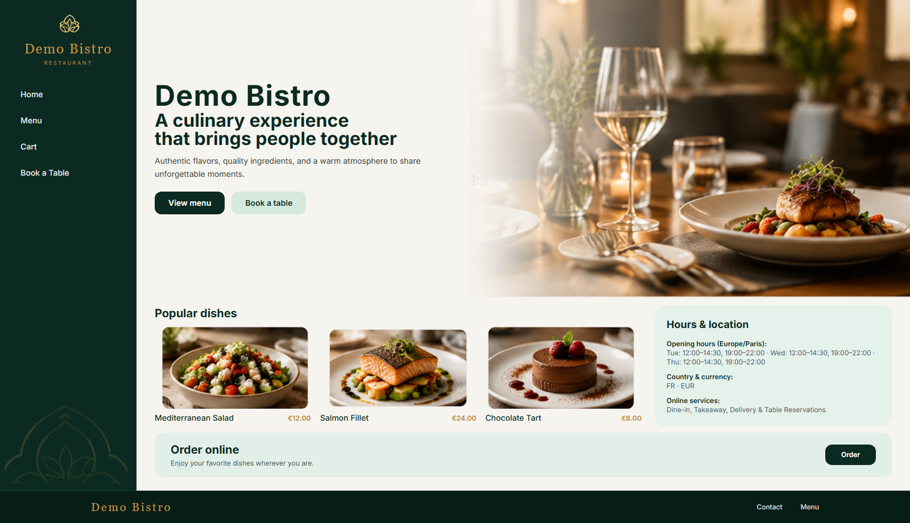
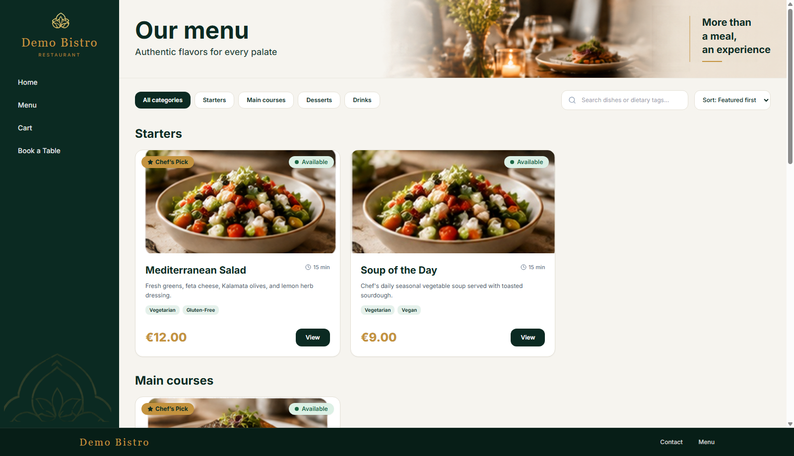
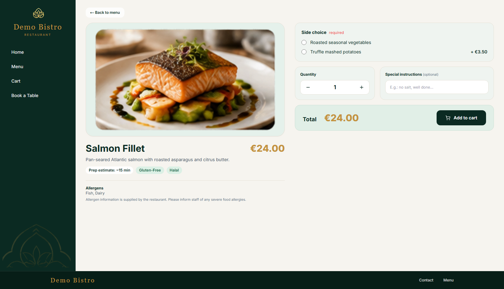
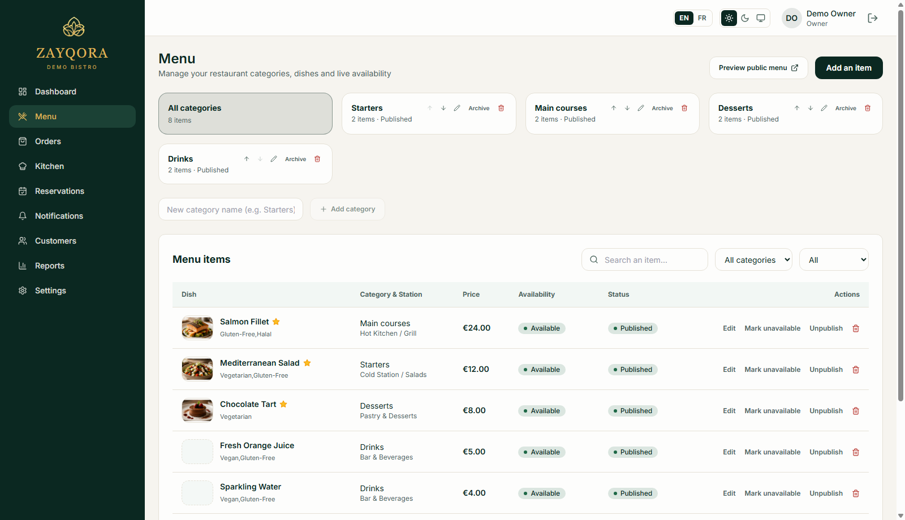
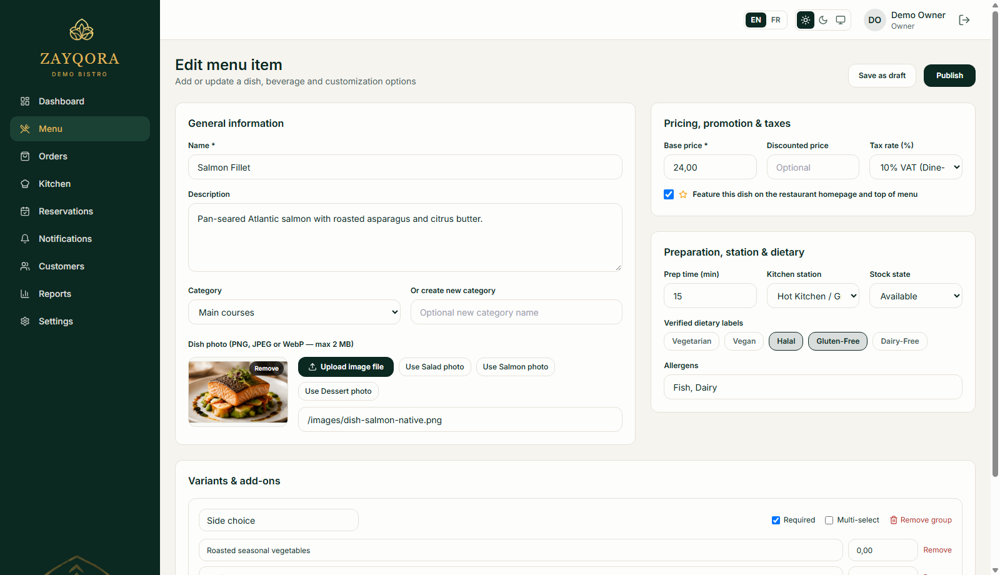
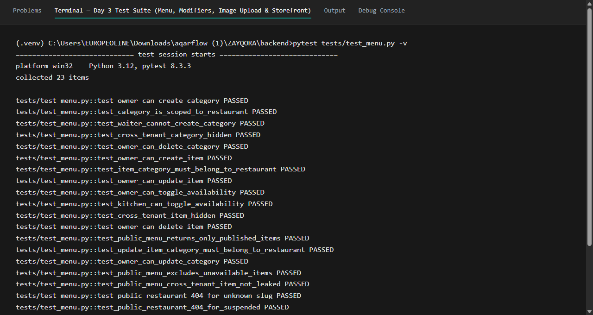

# Day 3 — Public Restaurant Storefront, Digital Menu & Image Management

Each published restaurant operates a branded public storefront at `/r/{slug}` and `/r/{slug}/menu` backed by a tenant-isolated catalogue (`menu_categories`, `menu_items`, `modifier_groups`, `modifiers`). In the workspace (`/menu` and `/menu/new`), owners and managers create, reorder, rename, archive and delete categories, upload validated dish photographs, configure base and discounted prices, map kitchen stations, assign dietary and allergen metadata, and define required or optional modifier groups.

## Acceptance criteria covered

| Criterion | Status |
|---|---|
| Alembic migrations `0002_day3_menu` and `0008_menu_enhancements` create `menu_categories`, `menu_items`, `modifier_groups` and `modifiers` with image, discount, station, dietary and featured columns | ✅ |
| `GET /api/v1/public/restaurants/{slug}` and `/menu` return active restaurant metadata and published, available dishes grouped by active category | ✅ |
| Unauthenticated requests for unknown, draft (`pending`) or `suspended` restaurant slugs return `404` | ✅ |
| `POST /api/v1/menu/images` validates file size (`<= 2 MB`), MIME type and binary magic bytes (PNG, JPEG, WebP) and stores files outside the web root | ✅ |
| `GET /api/v1/public/uploads/{restaurant_id}/{filename}` serves validated dish images with `X-Content-Type-Options: nosniff` | ✅ |
| `POST/GET/PATCH/DELETE /api/v1/menu/categories` and `/api/v1/menu/items` enforce tenant scoping and role permissions (`owner`, `manager`) | ✅ |
| `PATCH /api/v1/menu/items/{id}` validates `discounted_price_minor < price_minor`, persists modifier groups, and records price-change history (`old_price_minor`, `new_price_minor`) in `audit_logs` | ✅ |
| `PATCH /api/v1/menu/items/{id}/availability` allows `owner`, `manager` and `kitchen` staff to toggle live stock state | ✅ |
| Public storefront `/r/[slug]`, `/r/[slug]/menu` and `/r/[slug]/menu/[item]` are live, responsive across mobile/tablet/desktop, and display allergen disclosures | ✅ |
| Automated test suite covers 23 menu, modifier, image-upload, price-audit and cross-tenant isolation scenarios | ✅ |

---

## Public restaurant storefront (`/r/[slug]`)

When a restaurant is published (`status="active"`), its public homepage `http://localhost:3000/r/demo-bistro` displays the restaurant brand header, hero call-to-action buttons (`View menu` and `Book a table`), featured dishes (`Chef's Pick`) pulled from the live catalogue, and opening hours formatted in the restaurant's configured IANA timezone (`Europe/Paris`). On mobile and tablet viewports, the left navigation sidebar automatically collapses into a sticky top navigation bar.

---

## Interactive public menu catalogue (`/r/[slug]/menu`)

At `http://localhost:3000/r/demo-bistro/menu`, customers browse published categories (`Starters`, `Main courses`, `Desserts`, `Drinks`), filter by category pill, search by dish name, description or dietary label (`Vegetarian`, `Vegan`, `Gluten-Free`, `Halal`), and sort by featured priority or price (low-to-high / high-to-low). Each card displays the dish photograph, preparation time estimate, dietary badges, availability indicator, and formatted price (including strikethrough base price when a promotional discount is active), followed by the mandatory allergen accuracy notice at the bottom of the catalogue.

---

## Dish detail and customization (`/r/[slug]/menu/[item]`)

Clicking a dish opens `http://localhost:3000/r/demo-bistro/menu/{item_id}`, which renders the high-resolution dish image, description, preparation estimate, verified dietary tags, allergen disclosure, and interactive `DishCustomizer` for required single-select variants (e.g. `Side choice`), optional multi-select add-ons, quantity controls, and special kitchen instructions. The total updates dynamically before adding the item to the cart.

---

## Workspace menu and category management (`/menu`)

Inside the restaurant workspace, `http://localhost:3000/menu` provides complete catalogue control:
- **Category cards**: filter by category, create new categories, reorder display position (`↑` / `↓`), rename inline, archive/publish (`is_active`), or delete categories.
- **Menu item table**: displays dish thumbnails, category and kitchen station (`Hot Kitchen / Grill`, `Cold Station / Salads`, `Pastry & Desserts`, `Bar & Beverages`), featured star indicator, dietary tags, base/discounted prices, live stock availability toggle (`Mark unavailable` / `Mark available`), and one-click publish/unpublish actions.
- **Public preview**: a `Preview public menu` button opens `/r/{slug}/menu` to inspect the customer-facing result.

---

## Dish editor, image upload and modifier groups (`/menu/new`)

At `http://localhost:3000/menu/new` (and `/menu/new?id={item_id}` when editing an existing dish), owners and managers configure:
- **Dish photo**: upload a local PNG, JPEG or WebP file (`POST /api/v1/menu/images` with binary signature verification), choose a preset photography asset, or paste an image URL.
- **Pricing, promotion & taxes**: base price, optional discounted price (validated `< base price`), VAT rate (`10%`, `5.5%`, `20%`, `0%`), and homepage `Featured` flag.
- **Preparation, station & dietary**: preparation time in minutes, kitchen station routing, stock availability, verified dietary labels, and allergen text.
- **Variants & add-ons**: dynamic modifier groups (`required`, `multi_select`) with per-option price deltas.

---

## Automated tests

Running `pytest tests/test_menu.py -v` in `backend/` executes **23 automated tests** covering category and item CRUD, modifier group persistence, PNG binary signature validation and rejection of spoofed uploads (`422`), price-change audit logging (`old_price_minor` / `new_price_minor`), kitchen staff availability toggling, and strict cross-tenant isolation (`404`).

---

## Known limitations

- Uploaded dish images are stored on the local non-executable filesystem (`backend/storage/uploads/{restaurant_id}/`) for development; production deployments should mount persistent object storage (S3-compatible bucket) behind the same media adapter.
