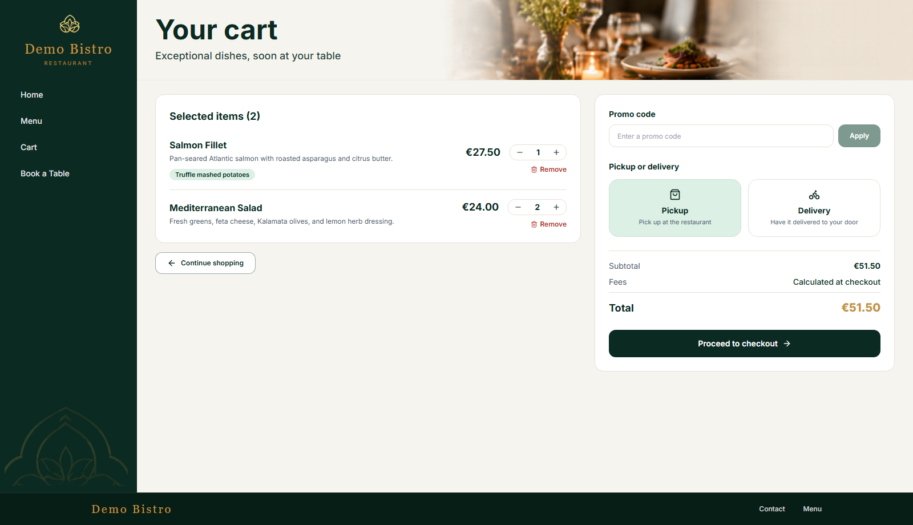
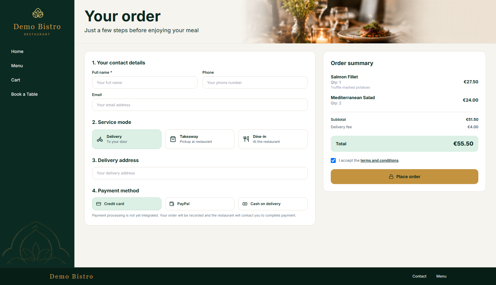
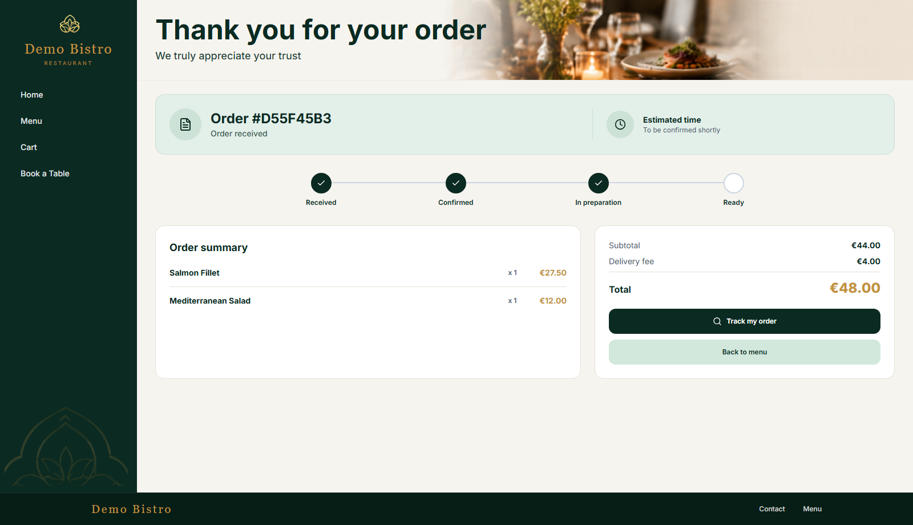
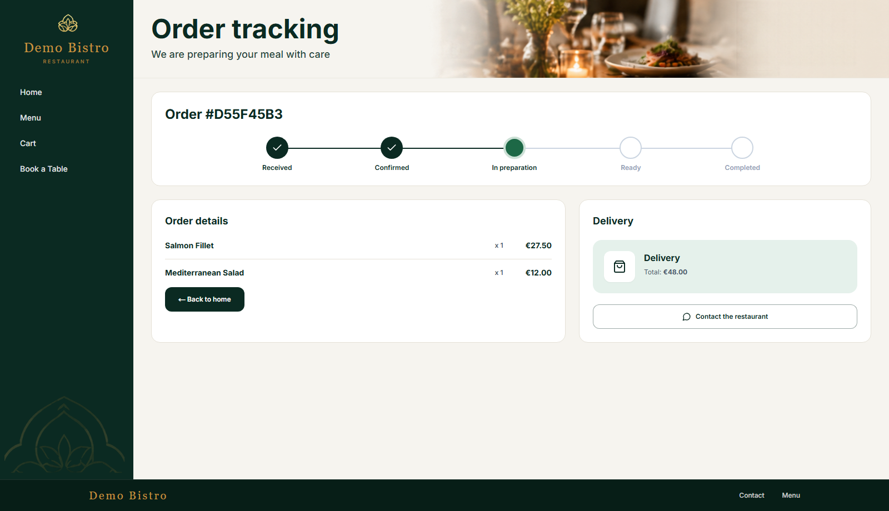
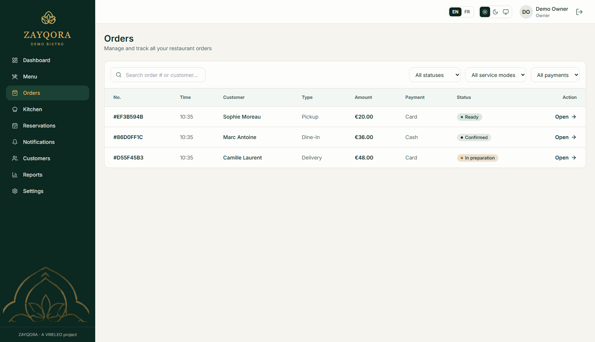
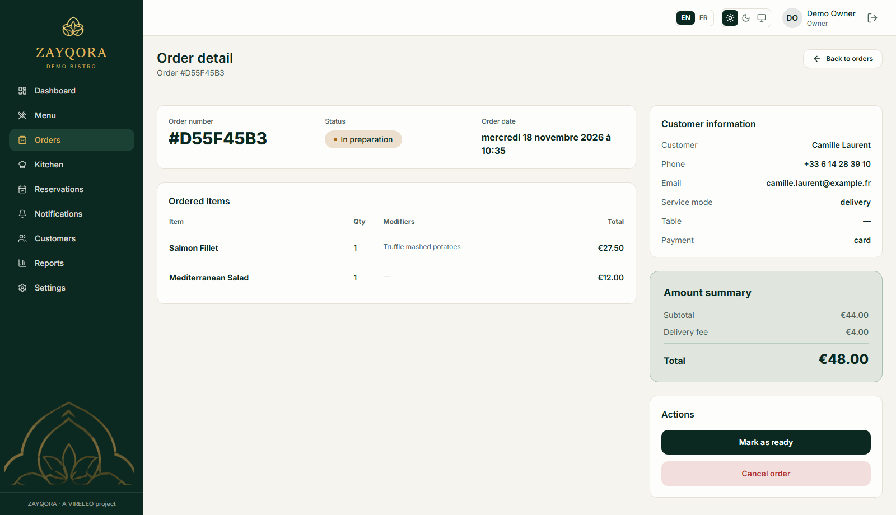
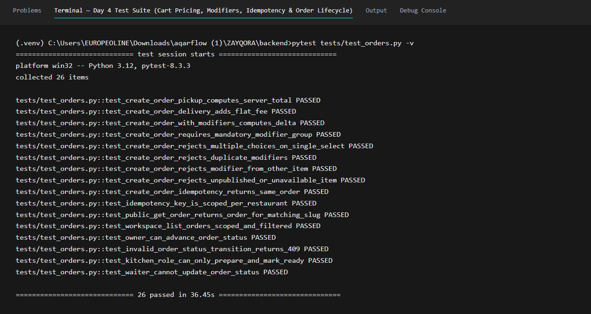

# Day 4 — Cart, Checkout, Idempotent Order Processing & Order Lifecycle

Customers can customize dishes, review and adjust their persisted shopping cart (`/r/{slug}/cart`), select a fulfilment mode (`delivery`, `pickup`, `dine-in`), and submit orders (`/r/{slug}/checkout`) protected by restaurant-scoped idempotency keys. The backend revalidates every item and modifier against the database, snapshots purchased names, modifiers and unit prices in minor units, notifies restaurant staff, and exposes live customer order confirmation and tracking pages alongside the workspace order management console (`/orders` and `/orders/{id}`).

## Acceptance criteria covered

| Criterion | Status |
|---|---|
| Alembic migrations `0003_day4_orders`, `0004_day4b_orders_hardening` and `0005_day4_order_integrity` create `orders` and `order_lines` with minor-unit totals, payment state and `(restaurant_id, idempotency_key)` uniqueness | ✅ |
| `POST /api/v1/public/orders?slug=` revalidates item publication/availability, enforces required and single-select modifier rules, and computes authoritative server-side totals | ✅ |
| Historical orders snapshot item names, unit prices (`discounted_price_minor` when active) and selected modifiers (`JSONB`) so later menu edits never alter past orders | ✅ |
| Duplicate checkout retries with the same `idempotency_key` (including concurrent race conditions caught via `IntegrityError`) return the existing order without double-creation | ✅ |
| `GET /api/v1/public/orders/{id}?slug=` powers customer confirmation and live status tracking without exposing internal staff notes | ✅ |
| `GET /api/v1/orders`, `GET /api/v1/orders/{id}` and `PATCH /api/v1/orders/{id}/status` enforce role permissions and state-machine transitions (`received` → `confirmed` → `in_preparation` → `ready` → `served` / `cancelled`) | ✅ |
| Zustand cart store (`lib/cart-store.ts`) persists per restaurant slug in `localStorage` and clears automatically after order placement | ✅ |
| Automated test suite covers 26 server-side pricing, modifier validation, idempotency, role-guard and cross-tenant order scenarios | ✅ |

---

## Persisted customer cart (`/r/[slug]/cart`)

At `http://localhost:3000/r/demo-bistro/cart`, customers inspect their selected dishes, chosen variants/modifiers, and line subtotals stored in the slug-scoped Zustand cart (`lib/cart-store.ts`). Customers can increment, decrement or remove lines, enter a promo code, and switch between `Pickup` and `Delivery` (which previews the flat `€4.00` delivery fee before checkout).

---

## Customer checkout with idempotency protection (`/r/[slug]/checkout`)

Proceeding to `http://localhost:3000/r/demo-bistro/checkout` generates a stable `crypto.randomUUID()` idempotency key for the checkout session. Customers enter their contact details, choose `Delivery`, `Takeaway (Pickup)` or `Dine-in`, provide a delivery address when required, select a requested payment method (`card`, `paypal`, `cash`), and submit `POST /api/v1/public/orders?slug=demo-bistro`. The backend recomputes every line price from the database, persists the `Order` and `OrderLine` snapshots in a single transaction, dispatches an `order.created` staff notification, and redirects the customer to the confirmation screen.

---

## Order confirmation and live customer tracking (`/r/[slug]/order-confirmation/[id]` & `/r/[slug]/order-tracking/[id]`)

Immediately after checkout, `http://localhost:3000/r/demo-bistro/order-confirmation/{order_id}` displays the order reference (`#D55F45B3`), progress stepper (`Order received` → `Confirmed` → `In preparation` → `Ready` → `Served`), purchased item breakdown, and customer/service summary.

Clicking `Track my order` opens `http://localhost:3000/r/demo-bistro/order-tracking/{order_id}`, which renders a visual milestone bar and live status badge reflecting updates made by restaurant or kitchen staff.

---

## Workspace order management (`/orders` & `/orders/[id]`)

In the restaurant console, `http://localhost:3000/orders` lists tenant orders in reverse chronological order with instant search (by order reference or customer name) and filters by status (`received`, `confirmed`, `in_preparation`, `ready`, `served`, `cancelled`), service mode (`dine-in`, `pickup`, `delivery`), and payment method (`card`, `paypal`, `cash`).

Opening an order (`http://localhost:3000/orders/{order_id}`) shows the full line-item and modifier snapshot, customer contact details, amount breakdown (`Subtotal`, `Delivery fee`, `Total`), and role-aware transition controls (`OrderStatusActions`). Every status change writes to `audit_logs` and triggers a deduplicated staff notification.

---

## Automated tests

Running `pytest tests/test_orders.py -v` in `backend/` executes **26 automated tests** verifying server-side subtotal and delivery-fee calculation, modifier group rules (required groups, single-select enforcement, duplicate modifier rejection, cross-item modifier rejection), idempotency key deduplication per tenant, valid and invalid status transitions (`409` on illegal transitions), role guards (`kitchen` restricted to `in_preparation` and `ready`; `waiter` blocked from status changes with `403`), and cross-tenant `404` masking.

---

## Known limitations

- Online card/PayPal payment capture requires a merchant provider adapter and webhook credentials; orders currently record the customer's selected `payment_method` with `payment_status="pending"`.
- Delivery fee is a server-enforced flat `400` minor units (`€4.00`); zone-based delivery pricing is scheduled for a later phase.
