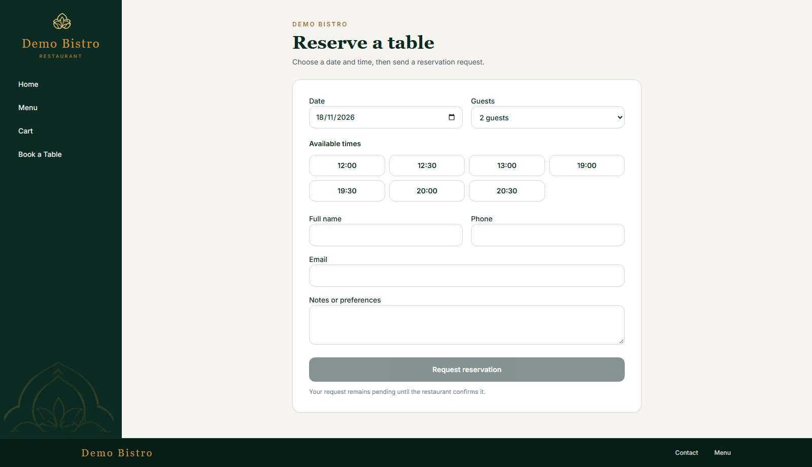
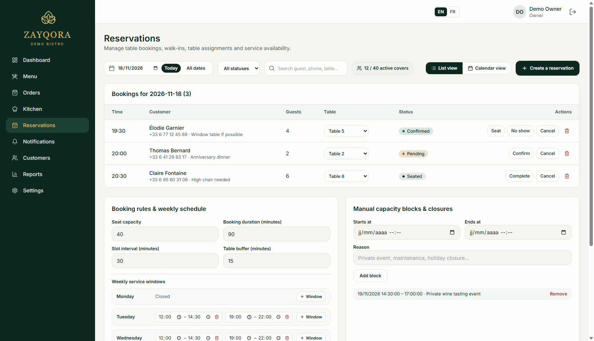
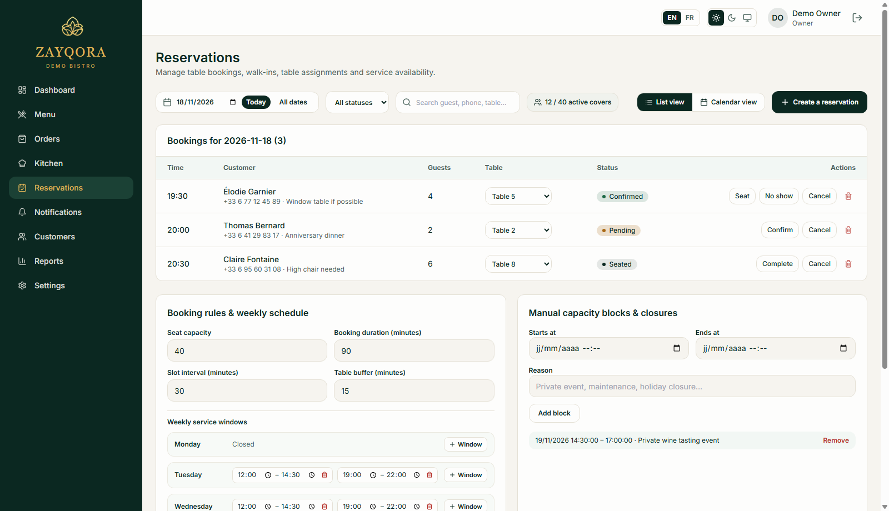
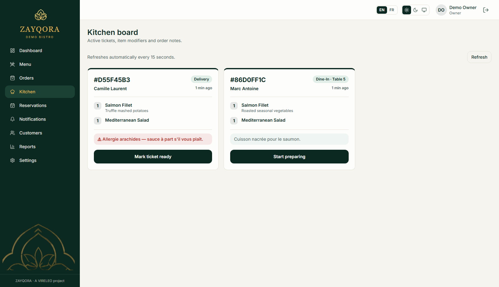
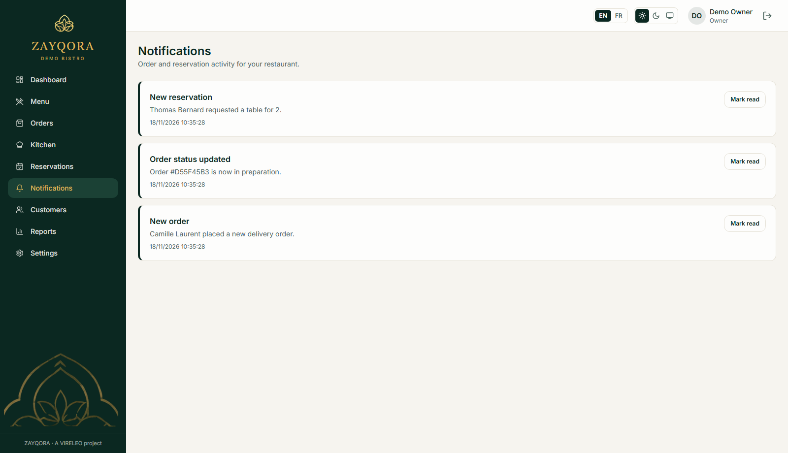
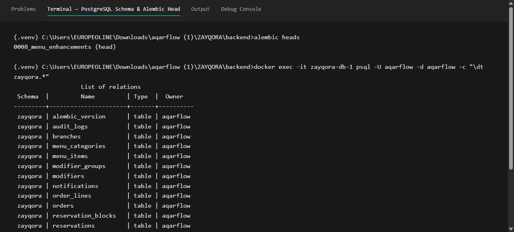
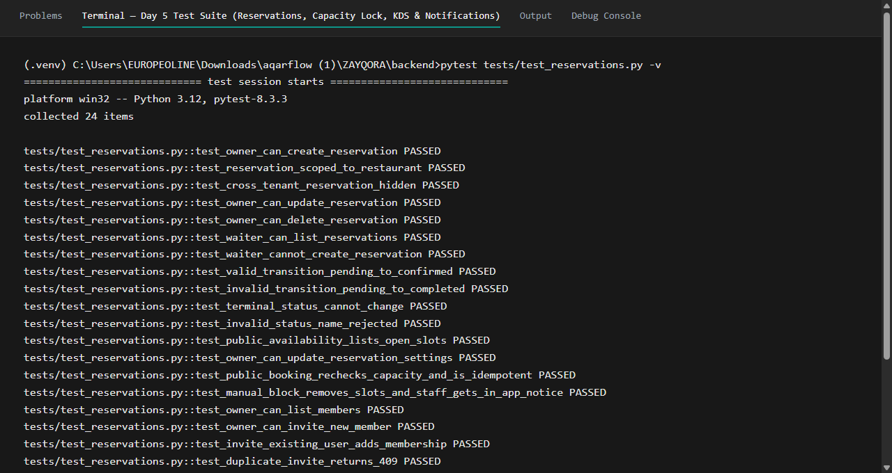

# Day 5 — Table Reservations, Kitchen Display System (KDS) & Staff Notifications

Customers can check real-time table availability and submit booking requests at `/r/{slug}/reservations` with transactional capacity locking (`SELECT ... FOR UPDATE`) and idempotency protection. In the workspace, staff manage bookings, walk-ins, table assignments, weekly opening hours and manual capacity blocks on `/reservations` (with both List and Calendar views), process active kitchen tickets on `/kitchen`, and review deduplicated operational alerts in `/notifications`.

## Acceptance criteria covered

| Criterion | Status |
|---|---|
| Alembic migrations `0005_day5_reservations`, `0006_merge_day4_day5` and `0007_day5_booking_notifications` create `reservations`, `reservation_blocks`, `notifications` and restaurant capacity/schedule columns | ✅ |
| `GET /api/v1/public/reservations/availability` computes valid booking slots in the restaurant's IANA timezone using opening windows, booking duration, slot interval, buffer time, seat capacity and manual blocks | ✅ |
| `POST /api/v1/public/reservations` locks the restaurant row (`with_for_update()`), rechecks remaining seat capacity to prevent double-booking, and enforces tenant-scoped idempotency | ✅ |
| Workspace `/reservations` provides date navigation (`Today`, date picker, `All dates`), status filtering, guest/table search, List & Calendar views, walk-in/phone booking creation, and inline table assignment | ✅ |
| Visual weekly schedule editor (`PUT /api/v1/reservations/settings`) and manual block manager (`POST/DELETE /api/v1/reservations/blocks`) replace raw JSON editing | ✅ |
| Role-based reservation transitions allow `owner`/`manager` full lifecycle control and `waiter` staff to mark confirmed bookings as `seated` or `completed` | ✅ |
| Kitchen Display System (`/kitchen`, `GET /api/v1/orders/kitchen`) displays active tickets, modifiers, elapsed timers and highlighted allergy warnings, and reconciles every 15 seconds | ✅ |
| Order and reservation lifecycle events create deduplicated per-staff in-app notifications (`GET /api/v1/notifications`, `PATCH /api/v1/notifications/{id}/read`) | ✅ |
| Full backend suite (**116 passed**), frontend TypeScript check and single-head Alembic migration graph verified | ✅ |

---

## Public table reservation flow (`/r/[slug]/reservations`)

At `http://localhost:3000/r/demo-bistro/reservations`, guests select their desired date and party size (`1` to `20` guests). The frontend queries `GET /api/v1/public/reservations/availability?slug=demo-bistro&date=YYYY-MM-DD&guests=N`, which evaluates the restaurant's weekly opening hours in its local IANA timezone (`Europe/Paris`), subtracts overlapping `pending`, `confirmed` and `seated` reservations (including `reservation_duration_minutes + reservation_buffer_minutes`), and excludes any window overlapping a `ReservationBlock`. Selecting a time slot and submitting the form creates a `pending` reservation protected by row-level locking and idempotency.

---

## Workspace reservation management (`/reservations` — List & Calendar views)

In the workspace at `http://localhost:3000/reservations`, managers and staff coordinate floor service:
- **Filters & cover counter**: switch between `Today`, any specific date or `All dates`, filter by status (`pending`, `confirmed`, `seated`, `completed`, `cancelled`, `no_show`), search by guest name, phone or table, and monitor active covers against total seat capacity (`12 / 40 active covers`).
- **Walk-in / phone reservations & table assignment**: click `Create a reservation` to book directly from the console (`POST /api/v1/reservations`), assign or move tables inline (`Table 1`–`Table 12`, `VIP Room`, `Terrace`), and trigger valid status transitions (`Confirm`, `Seat`, `Complete`, `No show`, `Cancel`).
- **Visual weekly schedule & manual blocks**: configure seat capacity, booking duration, slot interval, buffer time, day-by-day service windows (Monday–Sunday), and manual closures (e.g. private events or maintenance).

Switching to **Calendar view** displays the daily timeline slot-by-slot alongside the reservation list so floor staff can visualize peak seating windows at a glance.

---

## Kitchen Display System — KDS (`/kitchen`)

At `http://localhost:3000/kitchen`, kitchen staff view active tickets (`received`, `confirmed`, `in_preparation`) ordered by arrival time (`GET /api/v1/orders/kitchen`). Each card displays the ticket number, customer name, service mode (`delivery`, `dine-in` with table label, `pickup`), elapsed minutes since creation (highlighted in red when `>= 20 min`), item quantities, selected modifiers, and special instructions (with automatic visual warning highlighting when allergy keywords such as `allergie` / `allergy` are detected). One-touch buttons move tickets to `in_preparation` (`Start preparing`) and `ready` (`Mark ticket ready`), and the board reconciles automatically every 15 seconds.

---

## In-app staff notification centre (`/notifications`)

Order creations, order status transitions, new reservation requests and reservation status updates write deduplicated per-staff `Notification` rows in the same database transaction (`notify_restaurant_staff` using `(user_id, dedupe_key)` uniqueness). Staff review unread and historical alerts at `http://localhost:3000/notifications` and mark individual alerts as read (`PATCH /api/v1/notifications/{id}/read`).

---

## Database schema and automated tests

After applying the full Alembic migration chain (`alembic upgrade head` up to `0008_menu_enhancements`), PostgreSQL contains all **13 domain tables** in the `zayqora` schema (`alembic_version`, `audit_logs`, `branches`, `menu_categories`, `menu_items`, `modifier_groups`, `modifiers`, `notifications`, `order_lines`, `orders`, `reservation_blocks`, `reservations`, `restaurant_members`, `restaurants`, `user_sessions`, `users`).

Running `pytest tests/test_reservations.py -v` in `backend/` executes **24 automated tests** covering reservation CRUD, partial table-assignment updates, role-scoped status transitions (`waiter` seating/completion vs `owner`/`manager` confirmation), timezone-aware slot generation, transactional capacity locking (`409` when full), manual block exclusion, staff notifications, and team member management. Across the entire backend (`pytest -q`), all **116 automated tests** pass.

---

## Known limitations

- External email, SMS and WhatsApp notifications require third-party provider credentials and background worker queues; the MVP persists and delivers notifications through the in-app staff notification centre (`/notifications`).
- The KDS board reconciles via 15-second HTTP polling; WebSocket push streaming and multi-station ticket splitting remain scheduled for Release 2.
