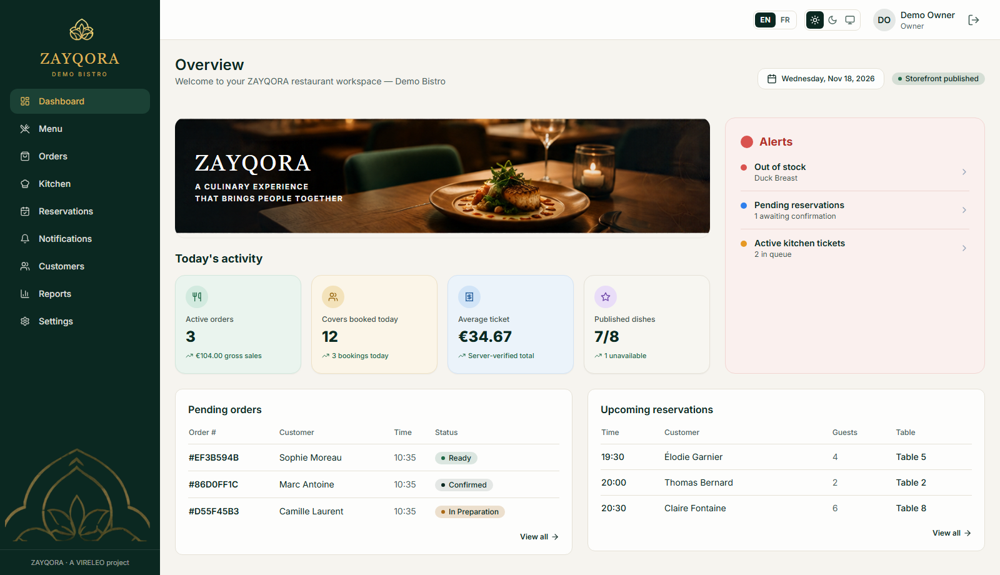
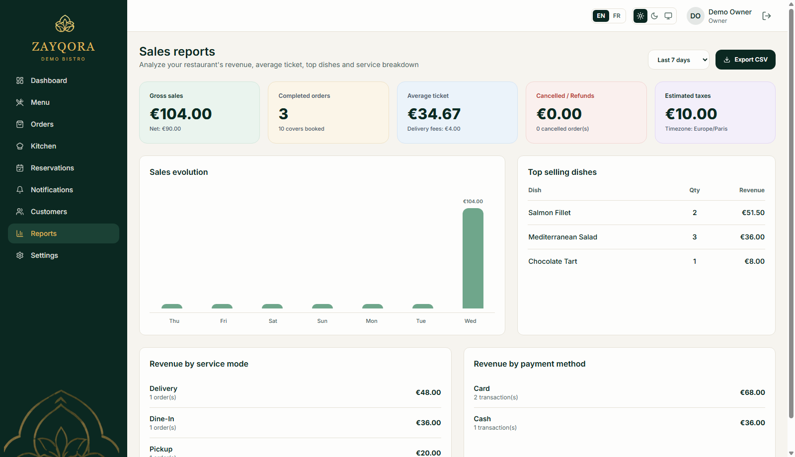
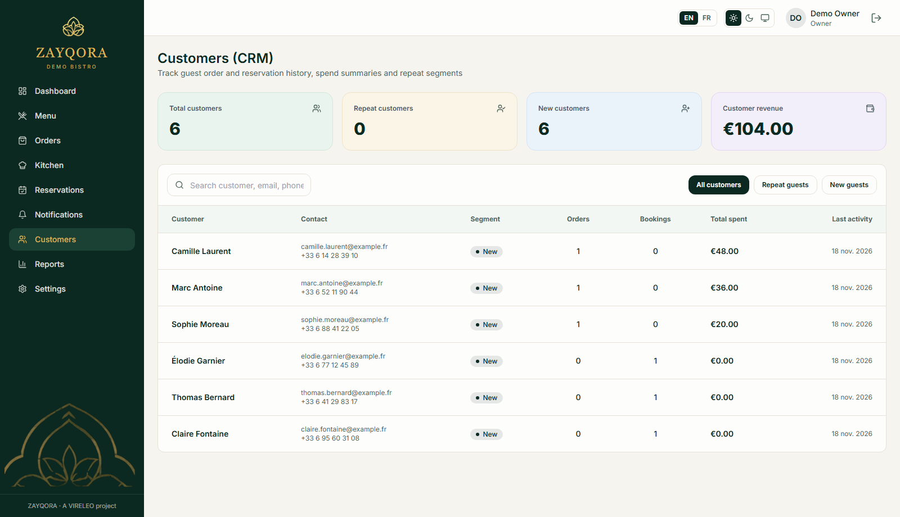
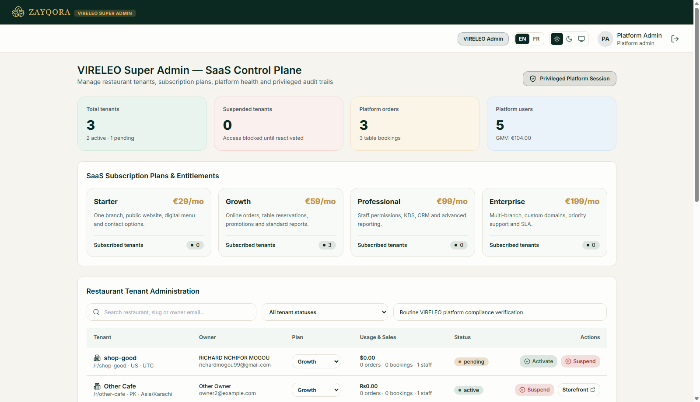
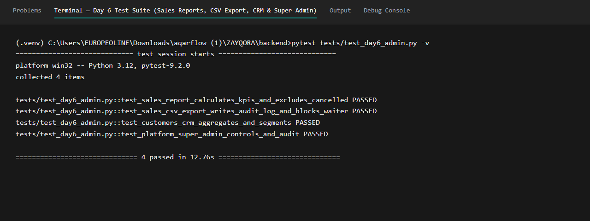

# Day 6 — Live Dashboard Metrics, Sales Reports, Customer CRM & VIRELEO Super Admin

The restaurant workspace dashboard (`/dashboard`), financial reporting (`/reports`), and customer relationship management (`/customers`) are now powered by live PostgreSQL aggregations. Platform administrators (`is_platform_admin=True`) have a dedicated VIRELEO SaaS control plane (`/platform`) to monitor platform-wide usage, manage subscription plans (`Starter`, `Growth`, `Professional`, `Enterprise`), activate or suspend restaurant tenants with mandatory audit reasons, and inspect the platform audit trail.

## Acceptance criteria covered

| Criterion | Status |
|---|---|
| Alembic migration `0009_day6_platform_plan` adds the `plan` subscription column (`starter`, `growth`, `professional`, `enterprise`) to `restaurants` | ✅ |
| `/dashboard` displays live tenant KPIs (active orders, gross sales, today's booked covers, server-verified average ticket, published/unavailable dishes), live operational alerts, recent orders and today's reservations | ✅ |
| `GET /api/v1/reports/sales?period=today\|7d\|30d` calculates gross sales, net sales, delivery fees, estimated taxes, cancelled/refunded totals, average order value, covers served, daily time series, top-selling dishes, and breakdowns by service mode and payment method | ✅ |
| `GET /api/v1/reports/sales/export?period=...` exports a downloadable CSV report with timezone and currency metadata and records `report.sales.export` in `audit_logs` | ✅ |
| Non-finance staff roles (`waiter`, `kitchen`) attempting to access `/reports/sales` or `/reports/sales/export` are blocked (`403`) | ✅ |
| `GET /api/v1/customers` aggregates tenant customers across orders and reservations, classifies `repeat` vs `new` segments, and supports search and segment filtering on `/customers` | ✅ |
| `GET /api/v1/platform/overview`, `GET /api/v1/platform/tenants` and `PATCH /api/v1/platform/tenants/{id}/status` enforce `require_platform_admin` (`403` for non-admins) and require a mandatory reason logged in `audit_logs` | ✅ |
| Automated Day 6 test suite (`tests/test_day6_admin.py`) and full backend test suite (**120 passed**) pass | ✅ |

---

## Live workspace overview (`/dashboard`)

At `http://localhost:3000/dashboard`, the static demo numbers from Day 1 have been replaced by live server-fetched data from `/restaurants/me`, `/orders`, `/reservations?date={today}`, and `/menu/items`:
- **KPI cards**: Active orders count and gross sales total, covers booked today, server-calculated average ticket, and published vs unavailable dish counts.
- **Live operational alerts**: Automatically surfaces out-of-stock menu items (`Duck Breast`), pending reservations awaiting confirmation, active kitchen tickets in queue, or draft storefront warnings.
- **Pending orders & today's bookings**: Live tables with clickable order references (`/orders/{id}`) and today's reservation schedule in the restaurant's IANA timezone.

---

## Sales reports and CSV export (`/reports`)

At `http://localhost:3000/reports`, owners, managers and accountants analyze business performance across `Today`, `Last 7 days`, or `Last 30 days` (`GET /api/v1/reports/sales`):
- **Financial KPIs**: Gross sales, Net sales (excluding delivery fees and estimated taxes), Completed orders, Average ticket, Cancelled orders total, and Estimated taxes.
- **Sales evolution & Top dishes**: Interactive daily revenue bar chart alongside the top-selling dishes ranked by revenue and quantity sold (`OrderLine` snapshots).
- **Service & payment breakdown**: Revenue and transaction counts split by service mode (`delivery`, `dine-in`, `pickup`) and payment method (`card`, `cash`, `paypal`).
- **Audited CSV export**: Clicking `Export CSV` downloads `sales-report-{slug}-{period}.csv` (`GET /api/v1/reports/sales/export`) and writes a `report.sales.export` entry in `audit_logs`.

---

## Customer CRM and segmentation (`/customers`)

At `http://localhost:3000/customers`, staff view the restaurant's customer directory (`GET /api/v1/customers`) aggregated from historical orders and table reservations:
- **CRM summary cards**: Total customers, Repeat customers (`>= 2` orders/bookings), New customers, and cumulative customer revenue.
- **Search & segment filters**: Instant search by guest name, email or phone number, and one-click filtering between `All customers`, `Repeat guests` and `New guests`.

---

## VIRELEO Super Admin & SaaS control plane (`/platform`)

Signing in with the platform administrator account (`platform@example.com` / `ChangeMe123!`) opens `http://localhost:3000/platform`:
- **Platform KPIs**: Total tenants (`Active`, `Pending`, `Suspended`), total platform orders, table bookings, registered users, and cumulative platform GMV.
- **SaaS Subscription Plans**: Overview of `Starter` (€29/mo), `Growth` (€59/mo), `Professional` (€99/mo), and `Enterprise` (€199/mo) tiers with active tenant counts.
- **Tenant administration**: Search and filter tenants by status, assign or upgrade subscription plans, and `Activate` or `Suspend` a tenant with a mandatory audit reason (`PATCH /api/v1/platform/tenants/{id}/status`). Suspending a tenant immediately revokes public storefront access (`404`) and blocks workspace access (`403`).
- **Privileged audit trail**: Displays the latest 25 platform and tenant audit log entries (`AuditLog`) with timestamps, action codes, entity references and JSON payloads.

---

## Automated tests

Running `pytest tests/test_day6_admin.py -v` in `backend/` executes the Day 6 test suite verifying KPI calculations, cancelled-order exclusion, audited CSV exports, waiter permission denial (`403`), CRM customer segmentation, platform admin authorization (`403` for regular owners), and audited tenant suspension/reactivation.

---

## Known limitations

- SaaS plan assignment (`Starter`, `Growth`, `Professional`, `Enterprise`) is managed by VIRELEO platform administrators; automated recurring subscription billing via Stripe webhooks is scheduled for Release 2.
