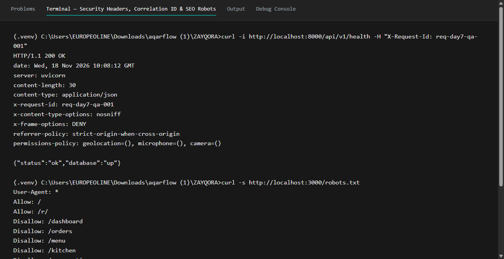
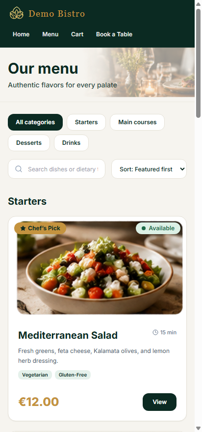
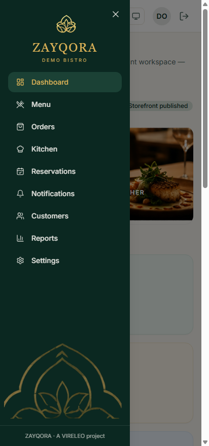
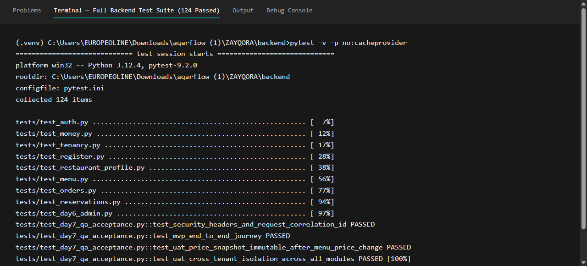
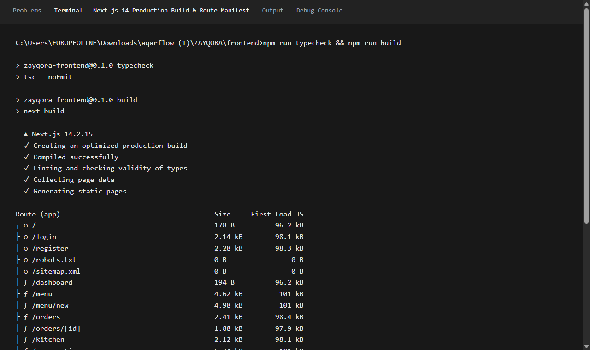

# Day 7 — Quality Assurance, Security Hardening, SEO, CI/CD & Production Readiness

The 7-day ZAYQORA MVP release is complete, verified end-to-end, and packaged for containerized deployment. Every HTTP response carries security headers and a traceable `X-Request-Id` correlation identifier, public restaurant storefronts expose dynamic SEO metadata alongside `/robots.txt` and `/sitemap.xml`, responsive mobile layouts are verified across public and workspace views, and the full 124-test automated suite runs in GitHub Actions CI/CD.

## MVP acceptance checklist (Section 20.2)

| # | Acceptance criterion | Status |
|---|---|---|
| 1 | A restaurant owner can register, verify the account and create a restaurant workspace | ✅ |
| 2 | The owner can configure localization, opening hours and publish a public restaurant website (`/r/{slug}`) | ✅ |
| 3 | The owner can create menu categories, food items, validated dish images, variants, dietary tags and item availability | ✅ |
| 4 | A customer can browse the public menu, customize an item, see a server-calculated total and submit an order | ✅ |
| 5 | The backend creates one order for one valid checkout request and safely handles duplicate retries via idempotency keys | ✅ |
| 6 | The restaurant dashboard and KDS receive the order and authorized staff can update valid statuses | ✅ |
| 7 | The customer can view order confirmation and live tracking status without seeing private restaurant data | ✅ |
| 8 | A customer can request a reservation and the system prevents conflicting bookings under defined capacity rules and locks | ✅ |
| 9 | An authorized owner can view live sales/order reports, export audited CSV reports and inspect Customer CRM segments | ✅ |
| 10 | VIRELEO super admin can manage tenant status and subscription plans (`Starter`, `Growth`, `Professional`, `Enterprise`) with mandatory audit reasons | ✅ |
| 11 | Tenant isolation tests prove Restaurant A cannot read or modify Restaurant B data across all modules (`404` masking) | ✅ |
| 12 | Critical actions are logged in `audit_logs` and production secrets are kept in environment configuration | ✅ |
| 13 | Automated tests (**124 passed**), TypeScript check, Next.js production build, Docker Compose topology and CI/CD pipeline are in place | ✅ |

---

## Security headers, correlation IDs & SEO readiness

Every backend response goes through `security_and_correlation_middleware` (`backend/app/main.py`), attaching or preserving `X-Request-Id` and enforcing `X-Content-Type-Options: nosniff`, `X-Frame-Options: DENY`, `Referrer-Policy: strict-origin-when-cross-origin`, and `Permissions-Policy: geolocation=(), microphone=(), camera=()` (plus `Strict-Transport-Security` when `ENV=production`).

On the frontend, `app/robots.ts` and `app/sitemap.ts` allow search engine indexing on public marketing and restaurant storefront routes (`/`, `/r/*`) while explicitly disallowing private workspace, customer and platform administration routes (`/dashboard`, `/orders`, `/menu`, `/kitchen`, `/reservations`, `/notifications`, `/customers`, `/reports`, `/settings`, `/platform`, `/api/`).

---

## Responsive mobile experience (Storefront & Workspace Drawer)

Both the customer-facing storefront (`/r/{slug}/*`) and the staff workspace (`/dashboard`, `/menu`, `/orders`, `/kitchen`, `/reservations`, `/reports`, `/customers`, `/settings`) adapt cleanly to mobile (`412×880`) and tablet viewports:
- **Mobile Storefront**: Replaces the desktop sidebar with a sticky brand header and quick navigation pills (`Home`, `Menu`, `Cart`, `Book a Table`).
- **Mobile Workspace Drawer**: Provides a slide-out navigation drawer accessible from the top-left menu toggle across all workspace screens.

| Mobile Storefront (`/r/demo-bistro/menu`) | Mobile Workspace Drawer (`/dashboard`) |
|---|---|
|  |  |

---

## End-to-end acceptance & full backend test suite (124 passed)

`tests/test_day7_qa_acceptance.py` validates the complete Section 20.2 & 20.3 acceptance scenarios in automated integration tests:
- **End-to-end lifecycle (`test_mvp_end_to_end_journey`)**: Owner registration → localization & storefront publication → category & dish creation with required modifiers → public menu discovery → idempotent checkout → KDS & order status progression (`received` → `confirmed` → `in_preparation` → `ready` → `served`) → public order tracking → table reservation booking → sales report & CRM repeat-customer verification.
- **Historical price snapshot immutability (`test_uat_price_snapshot_immutable_after_menu_price_change`)**: Raising a dish's menu price after an order is placed leaves the historical order's `unit_price_minor` and `total_minor` untouched.
- **Cross-tenant isolation sweep (`test_uat_cross_tenant_isolation_across_all_modules`)**: Verifies that Tenant A receives `404` when querying Tenant B across `/restaurants/me`, `/menu/categories`, `/menu/items`, `/orders`, `/reservations`, `/notifications`, `/reports/sales`, and `/customers`.

---

## Production build, Docker topology & CI/CD pipeline

- **Frontend production build**: `npm run typecheck && npm run build` compiles all 22 static and dynamic App Router routes cleanly (`frontend/Dockerfile`).
- **Containerized stack**: `docker-compose.yml` orchestrates `db` (`postgres:16`), `backend` (`FastAPI` with healthcheck), and `frontend` (`Next.js 14` production server).
- **CI/CD pipeline**: `.github/workflows/ci.yml` runs on every push and pull request to `main` and `dev`, executing Alembic head verification, the 124-test `pytest` suite against PostgreSQL 16, `tsc --noEmit`, and `next build`.
- **Operational runbook**: Documented in [deployment-and-runbook.md](../architecture/deployment-and-runbook.md).

